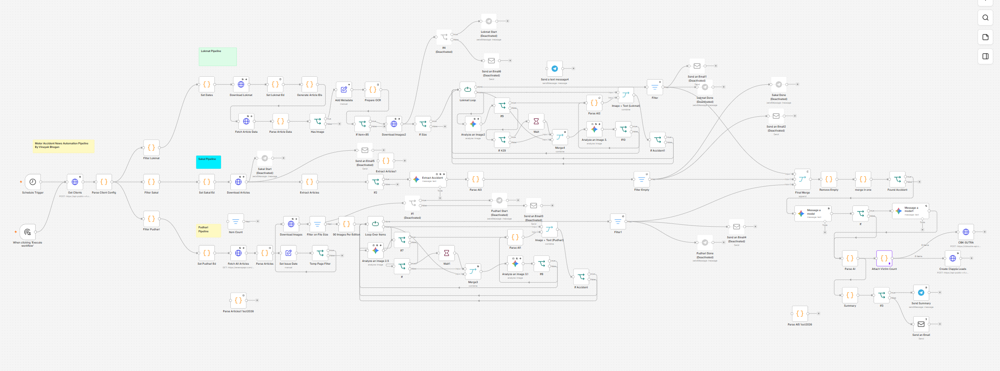

# Motor Accident News Automation Pipeline

**An n8n-based automation system for regional newspaper extraction and motor accident claim intelligence.**

## Overview

I designed and developed an n8n automation pipeline to process accident-related news from multiple regional newspapers and e-paper editions.

The objective is to reduce manual monitoring, identify relevant accident reports, structure extracted information, and support downstream motor accident claim workflows.

## Business Problem

Accident-related news appears across multiple newspapers and editions. Manually reviewing these sources and organizing relevant reports is time-consuming and difficult to scale.

## Solution

The pipeline automates newspaper data collection, AI-assisted accident identification, structured extraction, filtering, and downstream processing.

### Key Capabilities

- Multiple newspaper source pipelines: Lokmat, Sakal, and Pudhari.
- AI-assisted analysis of article text and images.
- Structured accident information extraction.
- Filtering and deduplication using accident location and publication date.
- Self-hosted n8n workflow orchestration.
- Workflow optimization to reduce unnecessary processing and AI token consumption.

## Architecture

The workflow contains source-specific processing branches that converge into downstream filtering, merging, and lead-processing stages.

See [Architecture Documentation](docs/architecture.md).

## Performance

Available execution history shows successful runs ranging from approximately 19 minutes 44 seconds to 28 minutes 24 seconds, with several runs around 20–22 minutes.

I optimized the workflow to reduce execution time and AI token consumption. Historical evidence for the original execution baseline is unavailable, so the earlier reported duration is not independently verified.

See [Performance Notes](docs/performance.md).

## Technology

- n8n workflow automation
- Google Gemini for AI-assisted analysis
- HTTP/API integrations
- Structured data processing
- Self-hosted automation infrastructure

## My Contribution

I designed and developed the end-to-end automation workflow, addressed real-world data processing challenges, implemented filtering and deduplication logic, and optimized execution performance.

The project demonstrates my approach to converting a practical business problem into a repeatable automation system.

## About Me

**Vinayak Bhogan — AI Solutions Architect**

29+ years of IT and product development experience, focused on AI automation, workflow engineering, solution architecture, and SaaS platforms.

LinkedIn: https://www.linkedin.com/in/vinayakbhogan

## Security and Scope

This public repository contains documentation and sanitized portfolio evidence only. It intentionally excludes the private production workflow export, credentials, API keys, private endpoints, and confidential records.
